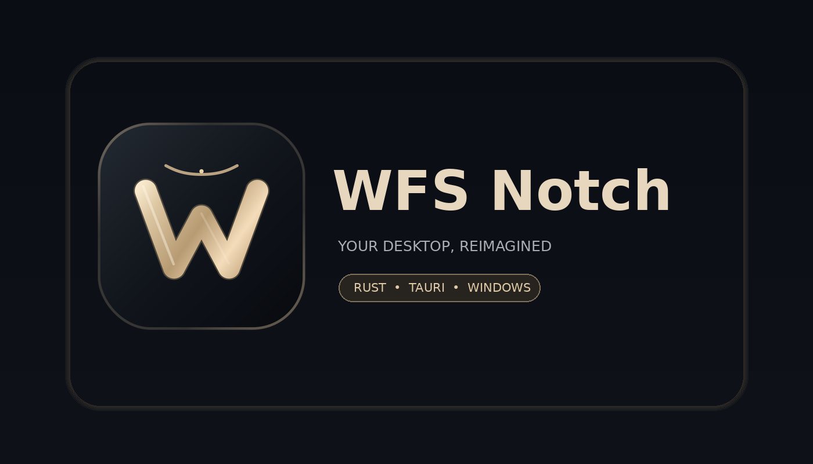

> **Reverse Engineering toolchain:** [REA (official)](https://github.com/morluto/rea), [Craft Anything](https://github.com/storytold/craft-anything), and [LeanREA](https://github.com/aicodeking/leanrea) can be used as complementary research tools. Windows opt-in setup and private reference analysis scripts: [REA + Craft Anything integration guide](01_ANALYSIS/REA_CRAFT_ANYTHING_INTEGRATION.md). Tools have not been run against the reference in this GitHub CI environment; no 100% parity is claimed.

# WFS Notch — Phase 8 / v0.8.0 (development)

**GitHub CI / publisher instructions:** [README_GITHUB.md](README_GITHUB.md). GitHub Actions builds Windows x64 installers; CI results are available in the repository Actions tab. Successful CI is not a native Windows user-interaction parity test.



**Status:** v0.8.0 development release. Browser regression and Windows build CI track code quality, but native desktop user-interaction and visual parity still need validation. Unsigned installer; not a 100% Poni replacement or production-certified.
WFS Notch is an original implementation built with a Rust + Tauri 2 backend and an HTML/CSS/JavaScript WebView front end. It does not redistribute or modify the supplied Poni binaries. It targets Windows 10/11 x64.

## Phase 8 — native Windows now playing + accessibility polish

- The Media panel reads current Windows GSMTC track title, artist, album, playback state, position and duration from a **read-only native Rust command**. Refresh runs only while the panel is active. Media key buttons are unchanged.
- Browser preview intentionally shows no fabricated track metadata. Availability depends on supported Windows media sessions; album cover, lyrics and multiple-player selection remain on the gap tracker.
- New keyboard shortcuts and visual refinements improve navigation, focus indicators and reduced-motion support. This is an **original WFS design**, not a 1:1 copy of proprietary UI assets.
- Merge requires passing browser regression, Rust tests/Clippy/rustfmt and Windows NSIS build. A successful build does not establish native desktop parity.

## Phase 7 — native disk/network monitoring

The Windows Rust backend now reads local disk total/used/free capacity and per-network-interface byte totals using the pinned sysinfo crate. The System panel requests details only while open, at most once per 15 seconds unless Refresh is pressed. Browser preview never substitutes synthetic values. This is **read-only** telemetry, not Wi-Fi controls, packet capture, GPU metrics or speed tests. No network access, administrator privilege or data upload is used by this feature. Native Windows device verification remains necessary.

## Phase 6 — calendar interoperability + searchable notes

- **Monthly calendar**: Monday-first month view, day selection that pre-fills the local event editor, event-count markers, and accessible navigation.
- **iCalendar (ICS)**: Paste/import or export local events through the Rust backend (no network). A 256 KiB size cap, 250-event import limit, transactional validation, and UID deduplication protect existing data. Export text can be copied and saved as `.ics` via a text editor.
- **Supported ICS timestamp**: `DTSTART:YYYYMMDDTHHMMSSZ` (UTC). Explicit `TZID`, floating-time and all-day imports are rejected rather than misinterpreted; this is not automatic iCal subscription or Google/Outlook sync.
- **Notes**: Instant case-insensitive search across titles and bodies, without changing the selected note or its autosave queue.
- **Verification**: Rust unit tests and a dedicated browser regression were added. Native Windows workflow results are tracked in GitHub Actions, not assumed.

## Phase 4 — expanded desktop features (v0.4.0 preview)

| Module | Implementation | Limitations |
| --- | --- | --- |
| Habits | Daily check-ins, streaks, Rust persistence & backup | No cloud sync |
| Dock | 5 built-in Windows launchers and user-pinned safe http(s) URLs | No automatic installed-app scanning |
| Media | Play/Pause, Next, Previous, Stop, Mute, Volume via Windows media keys | No metadata, lyrics or cover art |
| Quick Tools | Stopwatch & laps, secure password generation, calculator | Passwords not saved; copy requires permission |
| Command palette | Ctrl+K inside focused notch | No global OS shortcut |
| System tray | Show, Exit, close-to-hide | Windows runtime validation required |
| Autostart | Explicit opt-in HKCU Run value | Windows runtime validation required |

**Validation:** CI covers Rust tests, Clippy, Windows build and browser workflows. Browser preview is not proof of native Windows runtime behavior. This is not yet a full Poni replacement.

## Features delivered through Phase 3

| Module | Scope in this source | Verification |
| --- | --- | --- |
| Always-on-top notch | compact/expanded overlay and pin, position on current monitor | Code only; native Windows unverified |
| Tasks | add, complete, delete, persistent state | Browser smoke PASS; Rust uncompiled |
| Notes | create, edit, autosave, delete, serialized writes | Browser smoke PASS; Rust uncompiled |
| Focus timer | 15/25/45/60 min presets, pause/resume, elapsed-time-aware persistence | Browser smoke PASS; Rust uncompiled |
| Appearance | accent selection, hover and pin settings | Browser smoke PASS; Rust uncompiled |
| **Calendar (new)** | add, edit, delete local events, reminder offset 0/5/15/30/60 min, local timezone rendering | Browser Phase 3 PASS; Rust uncompiled |
| **Reminders (new)** | an in-app banner within 10 minutes of the due time, once per event per application session | Browser Phase 3 PASS; NOT Windows native toasts/background alarm |
| **System (new)** | Rust `sysinfo` global CPU and used/total RAM polling (4s, only while panel open) | Rust code only; browser preview intentionally has no simulated numbers |
| **Local backups (new)** | manually create dated snapshots in the user app-data folder, list up to 100 valid backups, restore with confirmation | Browser Phase 3 PASS; native disk I/O unverified |

**Unimplemented:** native media sessions, lyrics, Windows notification interception, background notifications while closed, external calendar/ICS sync, dock, file shelf, clipboard integration, Wi-Fi/Bluetooth controls, AI chat, weather, translations, snap layout, autostart, auto-update, signed installer and many advanced Poni reference features. No user data is sent to servers by the present code.

## Structure

- `00_INSTRUCTIONS/`: development REA prompt.
- `01_ANALYSIS/`: source/reference feature matrix, REA status, audits.
- `02_APP/src-tauri/`: Rust/Tauri application; all app storage, time validation, backups and telemetry commands.
- `02_APP/ui/`: local webview UI and browser-only localStorage preview adapter.
- `03_TOOLS/`: Windows build script, PE triage tool.
- `04_TESTS/`: Phase 2 regression, Phase 3 browser tests, structural audit.
- `05_BRANDING/`: original WFS Notch logos, SVGs, PNGs and Windows ICO.
- `06_EVIDENCE/`: browser screenshot evidence and test report.

## Build and use on Windows

1. Install current stable **Rust MSVC** (via rustup), Visual Studio C++ Build Tools with the Windows SDK, and Microsoft WebView2 Runtime. Use Windows 10/11 x64.
2. Install Tauri CLI 2 (this may require Internet for initial dependencies):

   ```powershell
   cargo install tauri-cli --version "^2" --locked
   ```

3. Open PowerShell in the extracted `WFS_Notch_Phase3` directory and run:

   ```powershell
   cd .\02_APP
   cargo tauri dev
   ```

4. For tests and NSIS build:

   ```powershell
   cd ..
   .\03_TOOLS\Build-WFSNotch-Windows.ps1
   ```

If the build succeeds, NSIS output will be under `02_APP\src-tauri\target\release\bundle\nsis\`. No installer is included in this ZIP; a Windows compiler is not present in the development runtime used to prepare this source. Unsigned executables may trigger SmartScreen warnings.

### Browser-only preview

Run `python -m http.server 8000` in `02_APP/ui`, then open `http://localhost:8000`. The preview works independently, but uses a separate **localStorage mock adapter**, so it cannot verify native window placement, Rust storage or real CPU/RAM values. It does not show fabricated telemetry.

## Data and privacy

- Rust state is saved in Tauri's per-user `app_data_dir()/state.json` (identifier `id.wfs.notch`). `state.json.bak` is the previous version and is not the same as a manual snapshot.
- Manual snapshots are named `backups/backup-...json` within the same app-data directory. The current application does not delete these backups automatically. Preserve a separate off-device copy for important data.
- Restore requires an explicit UI confirmation and overwrites current state. Restore validates backup size/JSON and uses the existing transactional save workflow.
- Calendar timestamps are Unix milliseconds (UTC), displayed in the user's local timezone. Reminders are **in-app only** while WFS Notch remains running and visible; no promise of OS background alarm delivery.
- `sysinfo` is fixed at version `0.33.1` until Windows-native compilation verifies an upgrade. The browser preview shows no fake system metrics.
- Existing Phase 1/2 `state.json` data loads with default empty `events` thanks to `serde(default)`. Database encryption, external export, and Windows native toast remain future milestones.

## Tests performed in the artifact environment

```powershell
node --check .\02_APP\ui\app.js
python .\04_TESTS\static_audit.py
python .\04_TESTS\browser_smoke.py
python .\04_TESTS\browser_phase3.py
```

Latest recorded results: **JavaScript syntax PASS; static audit PASS; Phase 2 browser regression PASS; Phase 3 browser integration PASS.** These checks do not prove `cargo test`, `cargo clippy`, installer building, Windows native dialog behavior, Windows file permissions, real system metrics or Windows smoke test. See `06_EVIDENCE/TEST_REPORT_PHASE3.md`.
